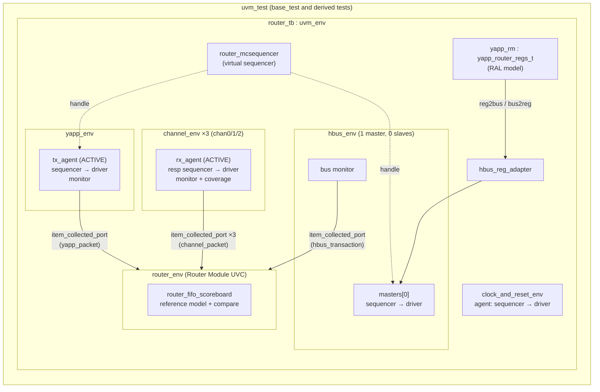

# UVM Verification Environment for the YAPP Packet Router

A complete, layered **UVM 1.2** testbench for **YAPP** ("Yet Another Packet Protocol"), a 1-input / 3-output packet router with a host-bus register interface. The environment combines four interface UVCs, a module-level UVC with a reference-model scoreboard, a virtual (multichannel) sequencer, and a **UVM register model (RAL)** with front-door and back-door access. Tests cover end-to-end data-path checking, register reset values, memory walking, register access policies, and register-to-hardware functional behavior.

> **Provenance.** The project follows the lab flow of the Cadence *SystemVerilog Advanced Verification with UVM* course. Cadence supplied the router RTL, the HBUS / Channel / Clock-and-Reset VIP skeletons, the generated register-model files, and the file templates (see `COPYRIGHT.TXT`). The work in this repository is the integration and verification layer built on top: the YAPP UVC, the testbench topology, the scoreboard and reference model (three versions), the virtual sequences, the test library, and the RAL integration and register tests.

---

## Table of Contents

1. [Project at a Glance](#1-project-at-a-glance)
2. [The Design Under Test (DUT)](#2-the-design-under-test-dut)
3. [Testbench Architecture](#3-testbench-architecture)
4. [Component Deep-Dive](#4-component-deep-dive)
5. [Checking Strategy: How the DUT Is Verified](#5-checking-strategy-how-the-dut-is-verified)
6. [Register Model (RAL) Integration](#6-register-model-ral-integration)
7. [Test Library](#7-test-library)
8. [Stimulus: Sequences and Constraints](#8-stimulus-sequences-and-constraints)
9. [Coverage and Assertions](#9-coverage-and-assertions)
10. [How to Run](#10-how-to-run)
11. [Directory Structure](#11-directory-structure)
12. [Design Decisions and Trade-offs](#12-design-decisions-and-trade-offs)
13. [Known Limitations and Future Work](#13-known-limitations-and-future-work)
14. [Interview Q&A: Questions a DV Engineer Would Ask](#14-interview-qa-questions-a-dv-engineer-would-ask)

---

## 1. Project at a Glance

| Item | Details |
|---|---|
| **DUT** | `yapp_router`: 1 input port, 3 output channels, 16-byte FIFO per channel, 8-bit host bus (HBUS) with registers and memories |
| **Methodology** | UVM 1.2 (with `UVM_VERSION_1_2` / UVM 1.1 compatibility guards for `starting_phase`) |
| **Language** | SystemVerilog (IEEE 1800) |
| **Simulator** | Cadence Xcelium (`xrun`), SimVision for waveforms and transaction recording |
| **Interface UVCs** | YAPP (TX, active), Channel ×3 (RX, active responder), HBUS (master), Clock & Reset |
| **Module UVC** | `router_env`: analysis exports, FIFO-based scoreboard, embedded reference model |
| **Register model** | `yapp_router_regs_t`: 9 registers + 256 B RW memory + 64 B RO packet memory, front door through the HBUS adapter, back door through HDL paths |
| **Tests** | 8 tests: data-path, multichannel virtual sequence, UVC integration, built-in RAL reset and mem-walk, register access, register function |
| **Checks** | Scoreboard with field-by-field compare, end-of-test FIFO-empty check, routing-ID check in the channel monitor, RAL `check_on_read` mirror compare, explicit read-back checks, SVA "input stuck in suspend" assertion |

### What the environment proves

1. **Routing correctness:** every legal packet comes out on the channel matching its address, with identical header, payload, and parity, in order.
2. **Drop behavior:** packets with an illegal address (`addr == 3`) or an oversized length (`length > maxpktsize`) are not forwarded.
3. **Configuration-dependent behavior:** the scoreboard follows HBUS register writes at run time, so the expected results change when `maxpktsize` changes during the test.
4. **Register correctness:** reset values, RW and RO access policies, front-door/back-door consistency, the RW memory, and hardware-updated counters that depend on the enable bits.

---

## 2. The Design Under Test (DUT)

### 2.1 Block diagram

```
                       ┌──────────────────────────────────────────────────────────┐
                       │                       yapp_router                        │
                       │                                                          │
  in_data[7:0]   ─────▶│  ┌─────────────┐  chan_data   ┌───────────┐  data_0     │──▶ Channel 0
  in_data_vld    ─────▶│  │  port_fsm   │─────────────▶│ fifo  (0) │  data_vld_0 │──▶
  in_suspend     ◀─────│  │             │ write_enb[0] │ 16 x 8b   │◀─ suspend_0 │◀──
                       │  │ HEADER_WAIT │─────────────▶└───────────┘             │
                       │  │ DATA_LOAD   │              ┌───────────┐  data_1     │──▶ Channel 1
                       │  │ DUMP_PKT    │─────────────▶│ fifo  (1) │  ...        │
                       │  │             │              └───────────┘             │
                       │  │ parity calc │              ┌───────────┐  data_2     │──▶ Channel 2
                       │  │ counters    │─────────────▶│ fifo  (2) │  ...        │
                       │  └──────▲──────┘              └───────────┘             │
                       │         │ max_pkt_size, en_reg, resets, int ctrl        │
                       │  ┌──────┴──────────────────────────────┐                │
  haddr[15:0]    ─────▶│  │  host_ctl (reg_file)                │                │
  hdata[7:0]     ◀────▶│  │  registers @ 0x1000..  RW mem 0x1100│                │
  hen, hwr_rd    ─────▶│  │  last-packet RO mem @ 0x1010        │                │
                       │  └─────────────────────────────────────┘                │
  error          ◀─────│  (parity error flag)                                    │
                       └──────────────────────────────────────────────────────────┘
```

### 2.2 YAPP packet format

A packet is a byte stream on `in_data`. `in_data_vld` is high from the header through the last payload byte. The parity byte is presented in the cycle where `in_data_vld` drops.

```
 Byte 0 (header)        Bytes 1..N (payload)       Last byte
┌───────────┬──────┐   ┌──────┬──────┬─────┐   ┌──────────┐
│length[7:2]│addr  │   │ D0   │ D1   │ ... │   │ parity   │
│  6 bits   │[1:0] │   │      │      │     │   │ 8 bits   │
└───────────┴──────┘   └──────┴──────┴─────┘   └──────────┘
   length = 1..63           N = length         parity = header ^ D0 ^ D1 ^ ... ^ D(N-1)
   addr   = 0,1,2 legal; 3 illegal
```

### 2.3 Router behavior (from `router_rtl/yapp_router.sv`)

The input FSM `port_fsm` has three states.

| State | Behavior |
|---|---|
| `HEADER_WAIT` | Waits for `in_data_vld`. Decodes the header. **`addr == 3`** → `DUMP_PKT` (increments the illegal-address counter if enabled). **`length > max_pkt_size` or `length == 0`** → `DUMP_PKT` (increments the oversized counter if enabled). Otherwise, it waits until the **destination FIFO is empty** (asserting `in_suspend` meanwhile), then increments the per-address counter (if enabled), writes the header, and moves to `DATA_LOAD`. |
| `DATA_LOAD` | Writes payload bytes into the selected FIFO. If that FIFO fills (`hold`), it asserts `in_suspend` for back-pressure. When `in_data_vld` drops, it writes the parity byte and returns to `HEADER_WAIT`. |
| `DUMP_PKT` | Discards bytes until `in_data_vld` drops. |

Other behavior that matters for checking:

- **Parity is checked but packets are not dropped on bad parity.** The DUT asserts `error` and increments `parity_err_cnt` (if enabled), but the bad-parity packet is still forwarded. The scoreboard therefore expects bad-parity packets on the output and compares the parity byte too.
- **Output side:** each channel FIFO is 16 × 8 bits. `data_vld_x = !empty && !almost_empty`. The receiver reads by de-asserting `suspend_x`.
- **Clocking:** the FSM and FIFOs update on the falling edge, and `data_vld_x` registers on the rising edge. The testbench drives on `negedge` and samples on `posedge` to avoid races.

### 2.4 Register map (HBUS, byte-addressed, base `0x1000`)

| Address | Register | Access | Reset | Description |
|---|---|---|---|---|
| `0x1000` | `ctrl_reg` | RW | `0x3F` | `[5:0] plen` = maximum packet length (`maxpktsize`) |
| `0x1001` | `en_reg` | RW | `0x01` | `[0] router_en`, `[1] parity_err_cnt_en`, `[2] oversized_pkt_cnt_en`, `[3] reserved`, `[4] addr0_cnt_en`, `[5] addr1_cnt_en`, `[6] addr2_cnt_en`, `[7] addr3_cnt_en` (illegal address) |
| `0x1004` | `parity_err_cnt_reg` | RO | `0x00` | Parity error count |
| `0x1005` | `oversized_pkt_cnt_reg` | RO | `0x00` | Oversized packet count |
| `0x1006` | `addr3_cnt_reg` | RO | `0x00` | Illegal-address (addr 3) packet count |
| `0x1009` | `addr0_cnt_reg` | RO | `0x00` | Packets accepted for channel 0 |
| `0x100A` | `addr1_cnt_reg` | RO | `0x00` | Packets accepted for channel 1 |
| `0x100B` | `addr2_cnt_reg` | RO | `0x00` | Packets accepted for channel 2 |
| `0x100D` | `mem_size_reg` | RO | `0x00` | Size of the last received packet |
| `0x1010` | `router_yapp_pkt_mem` | RO mem | — | Last received packet (64 B) |
| `0x1100` | `router_yapp_mem` | RW mem | — | General-purpose 256 B memory |

The RTL also has interrupt-enable (`0x1002`), interrupt-status W1C (`0x1003`), and reset (`0x100C`) registers. They are not in the register model, and the RTL header marks them as not fully tested.

---

## 3. Testbench Architecture

### 3.1 Topology



### 3.2 Signal-level connections (`hw_top`)

```
 hw_top
 ├── clkgen              → clock (period controlled by clock_and_reset_if)
 ├── clock_and_reset_if  cr_if     → drives reset, run_clock, clock_period
 ├── yapp_if             in0       → DUT in_data / in_data_vld / in_suspend
 ├── channel_if          ch0_if    ↔ DUT data_0 / data_vld_0 / suspend_0
 ├── channel_if          ch1_if    ↔ DUT data_1 / ...
 ├── channel_if          ch2_if    ↔ DUT data_2 / ...
 ├── hbus_if             hbus_if0  ↔ DUT haddr / hdata (inout) / hen / hwr_rd
 └── yapp_router         dut
```

### 3.3 Dual-top structure

- **`hw_top`** is synthesizable-style. It holds the clock generator, the interfaces, and the DUT, and has no class-based code. The interfaces contain the bus-functional tasks (`send_to_dut`, `collect_packet`, `master_send_to_dut`, …).
- **`tb_top`** imports all packages, publishes the virtual interfaces into `uvm_config_db` by hierarchical wildcard (for example `*.tb.chan0.*`), and calls `run_test()`.

This split, plus drivers and monitors that call **interface tasks** instead of toggling pins from classes, is the standard structure for **simulation acceleration / emulation** (for example Palladium). The HDL side can be moved onto the emulator unchanged. `clkgen.sv` has `IXCOM_1X` / `IXCOM_UXE` guards for this. The YAPP driver also copies the dynamic payload array into a static `payload_mem[0:63]` in the interface, because dynamic arrays cannot cross into synthesizable code.

### 3.4 Data flow of one packet

```
yapp_seq ──req──▶ yapp_tx_driver ──vif.send_to_dut()──▶ DUT input
                                                         │
                  yapp_tx_monitor ◀── samples posedge ───┤
                        │ write(yapp_packet)             │
                        ▼                                ▼
               router_env.yapp_in             DUT routes to FIFO[addr]
                        │                                │
                        ▼                                ▼
              scoreboard.yapp_fifo         channel_rx_driver lowers suspend
                        │                  (random resp_delay)
          filter by mirrored registers                   │
             (enable / addr / length)       channel_rx_monitor collects packet
                        │                                │ write(channel_packet)
                        ▼                                ▼
          chanN_get.get() ◀──────────────── scoreboard.chanN_fifo
                        │
                 comp_equal(yapp, chan)  →  match / miscompare counters
```

---

## 4. Component Deep-Dive

### 4.1 YAPP UVC (`yapp/sv`): input stimulus

| Component | Role |
|---|---|
| `yapp_packet` | Sequence item: `rand length[5:0]`, `rand addr[1:0]`, `rand payload[]`, `parity`. Control knobs: `rand parity_type` (GOOD/BAD), `rand packet_delay`. Implements `calc_parity()` and `set_parity()`, and calls `set_parity()` from `post_randomize()`. Uses field macros for copy/compare/print; `packet_delay` is `UVM_NOCOMPARE`. |
| `short_yapp_packet` | Subclass with `length < 15`, applied through a **factory type override**. |
| `yapp_tx_driver` | Pulls items with `get_next_item` / `item_done`. Waits for reset to finish, then calls `vif.send_to_dut()` and honors `in_suspend` at every byte. A parallel `reset_signals()` thread tri-states the bus on reset. Records transactions with `begin_tr` / `end_tr`, triggered from the interface `drvstart` flag. |
| `yapp_tx_monitor` | Calls `vif.collect_packet()`, sampling on `posedge` gated by `!in_suspend`. Recomputes `parity_type` from the observed parity and broadcasts on `item_collected_port`. |
| `yapp_tx_agent` | Active/passive configurable. The driver and sequencer are built only when `is_active == UVM_ACTIVE`. |
| `yapp_if` | Pins, BFM tasks, payload buffer, and the `YAPP_SUSPENDED` SVA. |

### 4.2 Channel UVC (`channel/sv`): output receiver and responder (×3)

The router's outputs use a ready/suspend handshake, so the receiving side is an **active responder agent**:

- `channel_resp` is the sequence item `rand resp_delay` (0..7 clocks): how long the receiver keeps `suspend` high before reading.
- `channel_rx_resp_seq` runs **forever** and raises no objection. On every `data_vld` it randomizes and sends a response, which produces **random back-pressure** on each output channel. A `channel_rx_long_resp_seq` (delays 0..65) is available for stress testing.
- `channel_rx_monitor` collects each output packet, **checks that `packet.addr == channel_id`** (a routing check at the monitor level), recomputes `parity_type`, samples coverage, and broadcasts the packet.
- `channel_id` is set per instance through `uvm_config_int::set(this, "chan0", "channel_id", 0)` and passed down to the agent's children.

### 4.3 HBUS UVC (`hbus/sv`): host bus master

- `hbus_transaction` has `haddr[15:0]`, `hdata[7:0]`, `hwr_rd` (READ/WRITE), and `wait_between_cycle`.
- A write is a single-cycle `hen` pulse. A read holds `hen` for two cycles and samples `hdata` on the second falling edge.
- `hbus_env` is parameterized by `num_masters` and `num_slaves`. The testbench configures **1 master and 0 slaves** because the DUT is the slave. A single shared `hbus_monitor` sees all traffic, so the scoreboard and the reference logic observe register writes **whoever issued them** (raw sequences or RAL).
- Sequence library: `hbus_small_packet_seq` (maxpktsize = 20, enable = 1), `hbus_set_default_regs_seq` (63, 1), `hbus_read_max_pkt_seq`, `hbus_set_get_regs_seq`, and others.
- `hbus_reg_adapter` (`uvm_reg_adapter`) implements `reg2bus` / `bus2reg`, which translate `uvm_reg_bus_op` to and from `hbus_transaction`.

### 4.4 Clock & Reset UVC (`clock_and_reset/sv`)

- Clock and reset are generated **by a sequence**, not hard-coded. `clk10_rst5_seq` sets a 10 ns clock period and holds reset for 5 cycles.
- The driver also offers a **clock-cycle counting service**. Sequences can request "notify me after N clocks", and the driver manages several outstanding requests in a sorted delta queue. This supports timeouts and drain waits.

### 4.5 Router Module UVC (`src/sv`): checking layer

`router_env` is a **reusable module-level UVC**. To the outside it exposes only five `uvm_analysis_export`s (`yapp_in`, `hbus_in`, `chan0_in`, `chan1_in`, `chan2_in`). The testbench connects monitors to these exports and never reaches into internal components. The checker implementation can therefore change (it did, three times; see §5.3) without touching `router_tb`.

### 4.6 Virtual sequencer (`src/tb/router_mcsequencer.sv`)

`router_mcsequencer` holds handles to the YAPP sequencer and the HBUS master sequencer, assigned in `router_tb::connect_phase`. `router_simple_mcseq` uses `` `uvm_declare_p_sequencer `` and `` `uvm_do_on(seq, p_sequencer.xxx_seqr) `` to interleave register programming and traffic in one ordered scenario.

---

## 5. Checking Strategy: How the DUT Is Verified

Checking is layered. No single check is relied on.

### 5.1 Transaction-level scoreboard with an embedded reference model

`router_fifo_scoreboard` (the active version) works as follows:

1. **Five `uvm_tlm_analysis_fifo`s** buffer transactions from the YAPP, HBUS, and three channel monitors, consumed through blocking `uvm_get_port`s.
2. **Register mirror thread** (`monitor_hbus`, forked with `join_none`): for every observed **HBUS write**, it updates the local mirror. `0x1000` updates `max_pktsize_reg`, `0x1001` updates `router_enable_reg`. Reset defaults are `0x3F` and `0x01`, matching the RTL.
3. **Main thread**: for each input YAPP packet, it predicts the DUT's decision:

   | Condition | Prediction |
   |---|---|
   | `router_enable_reg == 0` | Dropped (`ROUTER DISABLED`) |
   | `addr == 3` | Dropped (`BAD ADDRESS`) |
   | `length > max_pktsize_reg` | Dropped (`OVERSIZED`) |
   | otherwise | Expected on channel `addr`: block on `chanN_get.get()` and compare |

4. **Comparison** (`comp_equal`): field by field (`addr`, `length`, every `payload[i]`, `parity`), reporting the **first** mismatch with a `PKT_COMPARE` `uvm_error`.
5. **`check_phase`**: all three channel FIFOs must be **empty**. A leftover packet means the DUT produced output the model did not expect (an unexpected or duplicated packet, or a model mismatch).
6. **`report_phase`**: prints per-channel totals, passes, mismatches, and drops, and emits `Status: Simulation PASSED/FAILED`.

**Why ordering works.** Each output channel is FIFO-ordered and fed by a single input port, so for each destination the output order must equal the input order. Using one in-order queue per channel is enough. No associative matching or tagging is needed.

**Why bad-parity packets are expected on the output.** The DUT forwards them and only flags `error`. The model matches that, and comparing the parity byte proves the DUT passes the original parity through unchanged.

### 5.2 Additional checks

| Check | Where | What it catches |
|---|---|---|
| Routing ID | `channel_rx_monitor` | A packet appears on the wrong channel (`addr != channel_id`) |
| `YAPP_SUSPENDED` SVA | `yapp_if` | `in_suspend` held for more than 20 cycles: deadlock or bad suspend wiring. Calls `$finish` so the simulation cannot hang. |
| RAL `check_on_read` | `reg_function_test` | Every front-door read is compared against the mirror automatically |
| Explicit read-back | register tests | Directed `if (val !== exp) uvm_error` checks |
| `check_config_usage()` | `base_test::check_phase` | `config_db` settings that were never read, for example a mistyped path |
| `print_topology()` | `end_of_elaboration_phase` | Confirms the built hierarchy |

### 5.3 How the scoreboard evolved (three versions kept in `src/sv`)

| Version | Files | Architecture | Notes |
|---|---|---|---|
| **v1: imp-based scoreboard** | `router_scoreboard.sv` | `` `uvm_analysis_imp_decl(_yapp/_chan0/…) `` gives one `write_xxx()` per port. `write_yapp` **clones** and pushes into per-channel queues; `write_chanN` pops and compares. | Two selectable compare policies through `compare_policy`: `EQUALITY` (stops at the first mismatch) or `UVM_COMPARE` (`uvm_comparer.compare_field`, reports all mismatches). No register awareness. |
| **v2: reference + scoreboard** | `router_reference.sv` + `router_scoreboard.sv` | `router_reference` takes HBUS and YAPP imps, mirrors the registers, and forwards only legal packets through `sb_add_out` to the scoreboard. | Separates prediction from comparison. Counts drops per reason (`jumbo`, `bad_addr`, `disabled`). |
| **v3: FIFO-based (active)** | `router_fifo_scoreboard.sv` + `router_module_env.sv` | Analysis FIFOs plus `run_phase` threads. Reference logic is folded into the scoreboard. | Monitors return immediately (non-blocking `write`). The checker runs as **time-consuming tasks**, so it could wait on clocks or events if needed. The `router_env` exports are unchanged, so the testbench needed no change. |

### 5.4 Where each class of bug would be caught

| Bug | Caught by |
|---|---|
| Wrong output channel | Channel monitor ID check, plus the scoreboard (packet on the wrong FIFO, so a mismatch or a non-empty FIFO) |
| Corrupted / dropped / reordered payload byte | Scoreboard `comp_equal` |
| Legal packet dropped | Scoreboard blocks on the missing channel packet; later packets back up (see §13 for the reporting gap) |
| Illegal or oversized packet forwarded | Unexpected channel packet: miscompare or non-empty FIFO in `check_phase` |
| `maxpktsize` register not applied | Scoreboard (mirror updated from HBUS), `router_mcseq_test` |
| Counter not incrementing or not gated by enable | `reg_function_test` |
| Wrong register reset value | `uvm_reset_test` (`uvm_reg_hw_reset_seq`) |
| RO register writable / RW not writable | `reg_access_test` |
| Memory address decode or stuck bits | `uvm_mem_walk_test` |
| Back-pressure deadlock | `YAPP_SUSPENDED` assertion |

---

## 6. Register Model (RAL) Integration

### 6.1 Model structure

The model was generated by the Cadence register tool. It consists of `yapp_router_regs_rdb.sv`, `cdns_uvmreg_utils_pkg.sv`, and two data files read at time 0: `yapp_router_regs_config.dat` (fields, access, reset values) and `yapp_router_regs_hdlpaths.dat` (back-door paths).

```
yapp_router_regs_t            (top block, map "router" @ 0x0)
 ├── router_yapp_regs : yapp_regs_c   (sub-block, submap @ 0x1000)
 │     ctrl_reg, en_reg, parity_err_cnt_reg, oversized_pkt_cnt_reg,
 │     addr0/1/2/3_cnt_reg, mem_size_reg
 ├── router_yapp_pkt_mem  (RO, 64 x 8)   @ 0x1010
 └── router_yapp_mem      (RW, 256 x 8)  @ 0x1100
HDL root: hw_top.dut  →  block path: reg_file  →  e.g. reg_file.addr0_cnt_reg
```

### 6.2 Integration steps (`router_tb`)

```systemverilog
// build_phase
yapp_rm = yapp_router_regs_t::type_id::create("yapp_rm", this);
yapp_rm.build();
yapp_rm.lock_model();
yapp_rm.set_hdl_path_root("hw_top.dut");          // enables peek/poke back door
yapp_rm.default_map.set_auto_predict(1);          // implicit prediction
reg2hbus = hbus_reg_adapter::type_id::create("reg2hbus", this);

// connect_phase
yapp_rm.default_map.set_sequencer(hbus.masters[0].sequencer, reg2hbus);
```

### 6.3 Prediction strategy

The model uses **implicit (auto) prediction**: the mirror is updated from the RAL's own front-door operations. This is the simplest choice and is enough because the RAL is the only HBUS master in the register tests. It does **not** see register changes made by raw HBUS sequences, or counters updated by the hardware. `reg_function_test` handles the hardware-updated counters explicitly with `predict()` (see §7). The upgrade path is explicit prediction: a `uvm_reg_predictor #(hbus_transaction)` connected to the HBUS monitor (see §13).

---

## 7. Test Library

All tests extend `base_test`. `base_test` builds `router_tb`, sets a **2000 ns drain time** so FIFOs empty after the last objection drops, prints the topology, and runs `check_config_usage()`. Tests choose stimulus through **`default_sequence`** in `uvm_config_db` (`uvm_config_wrapper::set`) or by starting sequences explicitly in `run_phase`.

| Test | Stimulus | What it verifies |
|---|---|---|
| `base_test` | `yapp_5_packets` on the YAPP sequencer | Smoke test of the build and the topology |
| `simple_test` | Factory override to `short_yapp_packet`, `yapp_012_seq`, channel responders, `clk10_rst5_seq`. HBUS idle, so reset defaults apply. | Basic routing to all three channels with default registers |
| `test_uvc_integration` | `yapp_all_channels_seq`: **88 packets** = 4 addresses × lengths 1..22, about 20% bad parity, in parallel with `hbus_small_packet_seq` (maxpktsize = 20, enable = 1) | Full UVC integration. Intended outcome: 22 addr-3 drops, 6 oversized drops (lengths 21–22 on channels 0–2), and **60 forwarded packets (20 per channel)**, bad-parity ones included. The addr-3 part is affected by the constraint conflict in §13 item 7. |
| `router_mcseq_test` | Virtual sequence `router_simple_mcseq`: set maxpktsize = 20 → read it back → 6 packets to addresses 0/1/2 → set maxpktsize = 63 → read it back → 6 random packets | **Changing configuration at run time.** The short-packet override is deliberately off, so random lengths (1..63) exceed 20 and the scoreboard must predict oversized drops in phase 1 and none in phase 2. |
| `uvm_reset_test` | Built-in `uvm_reg_hw_reset_seq` | Every register's reset value matches the model |
| `uvm_mem_walk_test` | Built-in `uvm_mem_walk_seq` | Walking-pattern test of the RW memory at `0x1100` |
| `reg_access_test` | Directed front-door and back-door access | **RW `en_reg`:** write `0xA3` → peek must be `0xA3`; poke `0x55` → read must be `0x55`. **RO `addr0_cnt_reg`:** poke `0xCC` → read must be `0xCC`; write `0xFF` → peek must still be `0xCC` (the write must be ignored). The test values keep reserved bit 3 at 0. |
| `reg_function_test` *(default in `run.f`)* | RAL plus YAPP traffic, `check_on_read` enabled | See below |

### `reg_function_test`: checking register-to-hardware behavior

This test checks that the registers actually control the hardware:

1. `set_check_on_read(1)`: every read is compared against the mirror automatically.
2. Write `en_reg = 0x01` (router on, **all counters off**), then read it back.
3. Send `yapp_012_seq` (addresses 0, 1, 2). **All `addrN_cnt_reg` must stay 0**, which proves the enable gating works.
4. Write `en_reg = 0xFF` (all counters on). Send `yapp_012_seq` **twice**.
5. `predict(2)` for `addr0/1/2_cnt_reg`, because the hardware incremented them and the mirror cannot know that. Then read: addr0/1/2 = 2 and addr3 = 0.
6. `parity_err_cnt_reg` depends on the random bad-parity count, so the test **peeks** the real value, `predict`s it, then front-door reads. This checks the bus read path without hard-coding a random value. `oversized_pkt_cnt_reg` is predicted as 0, because every length is ≤ 63, the reset value of `maxpktsize`.
7. **Register introspection:** `get_registers()` / `get_fields()` / `get_access()` sort the registers into RW and RO lists and print them. This shows generic, model-driven test code.

---

## 8. Stimulus: Sequences and Constraints

### 8.1 Packet constraints (`yapp_packet`)

```systemverilog
constraint c_payload_size { length == payload.size(); }      // size tied to length
constraint c_length       { length > 0; length < 64; }
constraint c_delay        { packet_delay >= 0; packet_delay < 20; }
constraint c_parity_type  { parity_type dist { BAD_PARITY := 1, GOOD_PARITY := 5 }; }
constraint c_addr         { addr inside {0,1,2}; }           // legal by default
function void post_randomize(); set_parity(); endfunction    // derived field
```

- `parity` is **not** `rand`. It is derived in `post_randomize()` from the randomized `parity_type` knob, the usual pattern for computed fields.
- Directed values come from **inline constraints** (`` `uvm_do_with ``). Inline constraints are *added* to the class constraints; they don't replace them. So `yapp_all_channels_seq` asking for `addr == 3` conflicts with `c_addr`. See §13 item 7 for the effect and the fix (`constraint_mode(0)` or a subclass).

### 8.2 YAPP sequence library (`yapp_tx_seqs.sv`)

| Sequence | Purpose |
|---|---|
| `yapp_base_seq` | Raises and drops the objection in `pre_body` / `post_body` when it is the phase's default sequence |
| `yapp_5_packets` | 5 random packets |
| `yapp_1_seq`, `yapp_012_seq`, `yapp_111_seq` | Directed addresses; `yapp_111_seq` nests sequences |
| `yapp_repeat_addr_seq` | Two packets to the same randomized address (sequence-level `rand` field) |
| `yapp_incr_payload_seq` | `uvm_create` → randomize → overwrite the payload with `0,1,2…` → `set_parity()` → `uvm_send`, so the payload is easy to read in waveforms |
| `yapp_rnd_seq`, `six_yapp_seq` | Random count (1..10); a parent sequence constrains the child's count to 6 |
| `yapp_exhaustive_seq` | Runs every sequence above in order |
| `yapp_all_channels_seq` | Address × length sweep with a 20% bad-parity distribution |

---

## 9. Coverage and Assertions

| Item | Location | Contents |
|---|---|---|
| `cover_packet` | `channel_rx_monitor` (per instance) | `packet_length` bins ONE / SMALL (2–10) / MEDIUM (11–20) / LARGE / MAX (63); `packet_parity_type` |
| `cover_transaction` | `hbus_monitor` | Address × direction cross |
| RAL field coverage | generated `wr_fld_covg` / `rd_fld_covg` per register | Field-value coverage (`UVM_CVR_FIELD_VALS`); turned off in the register tests through `uvm_reg::include_coverage("*", UVM_NO_COVERAGE)` |
| `YAPP_SUSPENDED` | `yapp_if` | `!in_suspend ##1 in_suspend[*20] \|=> !in_suspend` |
| HBUS protocol SVA (template) | `hbus_if` (commented out) | Address not X during `hen`; read `hen` lasts 2 cycles; address stable during a read |

Coverage collection is wired in, but **no coverage-closure results are claimed**. Coverage-driven closure is listed in §13.

---

## 10. How to Run

### Prerequisites

- Cadence Xcelium (`xrun`) with its UVM 1.2 library. `tb_top` imports `cdns_uvm_addons`, which ships with the Cadence UVM distribution.
- `UVMHOME` set to the UVM library (for example `export UVMHOME=CDNS-1.2`).

### Commands

The register model reads its `.dat` configuration files from the current directory, and `run.f` uses paths relative to `src/tb`, so **run from `src/tb`**:

```bash
cd src/tb

# Default test (reg_function_test, set inside run.f)
xrun -f run.f

# Choose a test: either edit +UVM_TESTNAME in run.f, or put the
# option before -f (UVM uses the first +UVM_TESTNAME it sees and warns about the rest)
xrun +UVM_TESTNAME=router_mcseq_test -f run.f
xrun +UVM_TESTNAME=test_uvc_integration -f run.f

# More detail / fixed seed / GUI with transaction recording
xrun +UVM_TESTNAME=simple_test +UVM_VERBOSITY=UVM_MEDIUM -svseed 1234 -f run.f
xrun +UVM_TESTNAME=simple_test -f run.f -access +rwc -gui

# Negative test: the RTL has an INJECT_ERROR hook that corrupts writes to
# RW-memory offset 0x0F. The memory walk test should then FAIL.
xrun +UVM_TESTNAME=uvm_mem_walk_test +define+INJECT_ERROR -f run.f
```

### Reading the result

- The scoreboard `report_phase` prints `FIFO Scoreboard Statistics` and **`Status: Simulation PASSED`** or `FAILED`.
- The UVM report summary at the end must show **`UVM_ERROR : 0`** and **`UVM_FATAL : 0`**.
- Note that `+SVSEED=random` is set in `run.f`. Record the seed from the log to reproduce a failure.

---

## 11. Directory Structure

```
.
├── router_rtl/
│   └── yapp_router.sv            # DUT: yapp_router, port_fsm, fifo, host_ctl
├── yapp/sv/                      # YAPP input UVC (TX agent)
│   ├── yapp_if.sv                #   pins + BFM tasks + SVA
│   ├── yapp_packet.sv            #   sequence item + short_yapp_packet
│   ├── yapp_tx_{driver,monitor,sequencer,agent}.sv
│   ├── yapp_env.sv, yapp_pkg.sv
│   └── yapp_tx_seqs.sv           #   sequence library
├── channel/sv/                   # Channel output UVC (RX responder agent) ×3
├── hbus/sv/                      # Host-bus UVC (master/slave agents, monitor, reg adapter)
├── clock_and_reset/sv/           # Clock & reset UVC (sequence-driven clock/reset)
└── src/
    ├── sv/                       # Router Module UVC (checking layer)
    │   ├── router_module_pkg.sv  #   package (compiles the FIFO scoreboard + env)
    │   ├── router_module_env.sv  #   router_env: analysis exports → scoreboard
    │   ├── router_fifo_scoreboard.sv  # v3 (active): FIFO + reference logic
    │   ├── router_reference.sv   #   v2 reference model (kept for reference)
    │   ├── router_scoreboard.sv  #   v1/v2 imp-based scoreboard (kept for reference)
    │   └── packet_compare.sv     #   standalone compare function
    └── tb/
        ├── run.f                 # xrun file list and options
        ├── hw_top.sv, clkgen.sv  # HDL top: DUT + interfaces + clock gen
        ├── tb_top.sv             # HVL top: config_db vif setup + run_test()
        ├── router_tb.sv          # top-level uvm_env
        ├── router_mcsequencer.sv, router_mcseqs_lib.sv   # virtual sequencer/sequence
        ├── router_test_lib.sv, reset_test.sv             # tests
        ├── yapp_router_regs_rdb.sv, cdns_uvmreg_utils_pkg.sv  # RAL model
        ├── yapp_router_regs_config.dat, yapp_router_regs_hdlpaths.dat
        └── rm_integration.txt    # RAL integration notes
```

---

## 12. Design Decisions and Trade-offs

| Decision | Rationale | Trade-off |
|---|---|---|
| **Separate UVC per interface** | Each UVC is reusable on its own (a YAPP UVC could drive another YAPP device). Configured through `config_db` without code changes. | More files and boilerplate than a flat testbench |
| **Module UVC behind analysis exports** | The testbench only sees ports; the checker could change from imp-based to FIFO-based with no testbench edits. The module UVC can move to a system-level testbench. | One extra hierarchy level |
| **Reference model fed by the HBUS monitor, not by the test** | The model follows what actually happened on the bus, whoever caused it (raw sequences, RAL, a virtual sequence). | The model must know the register addresses; an RAL-driven predictor would remove that duplication (§13). |
| **FIFO-based scoreboard** | Monitors never block. The checker can consume time and is easy to extend (for example, latency checks). | Needs care at end of test: items left in FIFOs must be checked explicitly. |
| **Active channel responders with random delay** | Exercises FIFO-full → `hold` → `in_suspend` back-pressure, the most bug-prone part of the router. | Random delays make debug less direct; reproduce with a seed. |
| **`default_sequence` for simple tests, virtual sequence for ordered scenarios** | `default_sequence` runs agents independently and in parallel. The virtual sequence gives **deterministic ordering** between configuration and traffic. | Default sequences on several agents can race (for example HBUS configuration vs the first YAPP packet). |
| **Implicit RAL prediction** | Simple, and correct while the RAL is the only master | Misses hardware-side updates; needs `predict()` calls in tests |
| **Interface-task BFMs and dual top** | Ready for emulation; timing lives in one place (the interface) | Less flexible than clocking blocks for some timing checks |
| **Drive on negedge, sample on posedge** | Avoids race conditions between testbench and DUT without clocking blocks | Half-cycle timing assumptions |

---

## 13. Known Limitations and Future Work

These came from a critical review of the environment. Discussing them openly is part of the verification work.

1. **Missing-packet detection in the FIFO scoreboard.** If the DUT drops a packet the model expected, the main thread blocks on `chanN_get.get()`. `check_phase` checks that the **channel** FIFOs are empty, but not that `yapp_fifo` is empty or that `total == pass + mismatch` per channel, so a missing packet can end the test without a `UVM_ERROR`. **Fix:** in `check_phase`, also flag `yapp_fifo.used() != 0` and any per-channel shortfall, or use a per-channel expected queue with a timeout.
2. **Prediction timing vs DUT decision timing.** The YAPP monitor publishes a packet at **end of packet**, but the DUT decides at **header time**. An HBUS write that lands *during* a packet could make the scoreboard use a newer `maxpktsize` than the DUT did. The current tests avoid this through ordering (virtual sequence), but a mid-packet register change test would expose it. **Fix:** have the monitor send the header early through a second analysis port, or timestamp transactions.
3. **`router_en = 0` behavior not exercised.** The scoreboard predicts that a disabled router drops every packet. Reading the RTL, the `router_en_fld` check is nested inside the oversized-length branch of `HEADER_WAIT`, so a *legal* packet looks like it would still be forwarded with `router_en = 0`. No test currently sends traffic with the router disabled, so this spec-vs-RTL question is still open. It is the obvious next directed test.
4. **Coverage closure.** The covergroups exist but no closure plan or results are provided. The HBUS covergroup bins (`{0}`, `{1}`, `{[2:31]}`) don't match the real register addresses (`0x1000+`), so those bins would never be hit. **Next:** a verification plan mapping each feature to cover points, fixing the HBUS bins, and adding crosses (address × length bucket × parity × back-pressure).
5. **Explicit RAL prediction.** Replace `set_auto_predict(1)` with a `uvm_reg_predictor` on the HBUS monitor, and model the counters as volatile, or predict them from the scoreboard.
6. **More register coverage.** Add `uvm_reg_bit_bash_seq` and `uvm_reg_access_seq`; add the interrupt (IEN/INT W1C) and reset registers to the model.
7. **Constraint conflict for `addr == 3`.** `yapp_packet::c_addr` restricts `addr` to `{0,1,2}`, and `yapp_all_channels_seq` adds `addr == 3` inline. The solver can't satisfy both, so randomization of those 22 packets fails. `` `uvm_do_with `` only issues an `RNDFLD` *warning* and sends the item with unrandomized fields, so these packets are not the intended illegal-address traffic. Combined with item 1, this can pass silently. **Fix:** disable `c_addr` for that sequence (`req.c_addr.constraint_mode(0)` via `uvm_create` + `randomize() with`) or use an `illegal_addr_packet` subclass, and promote randomization failures to `uvm_error`.
8. **Regression automation.** A script or `vManager` regression running all tests over many seeds with pass/fail parsing.

---

## 14. Interview Q&A: Questions a DV Engineer Would Ask

<details open>
<summary><b>Q1. Walk me through your testbench architecture.</b></summary>

Two tops: `hw_top` (DUT, interfaces, clock generator) and `tb_top` (puts virtual interfaces into `config_db`, calls `run_test`). The test builds `router_tb`, which contains five interface UVC instances: YAPP TX (input stimulus), three Channel RX agents (output collection plus back-pressure), and an HBUS master (register programming). A clock & reset UVC generates clock and reset from a sequence. A Router Module UVC (`router_env`) holds the scoreboard and reference model behind analysis exports. A virtual sequencer coordinates YAPP and HBUS, and a RAL model drives the HBUS sequencer through an adapter.
</details>

<details>
<summary><b>Q2. How do you know the DUT is correct? What exactly does the scoreboard check?</b></summary>

For every input packet, the reference model predicts *forward* or *drop* from the current mirrored register values (router enable, address legality, length vs `maxpktsize`). For forwarded packets, it waits for the next packet on the matching channel and compares address, length, every payload byte, and parity. At end of test, every channel FIFO must be empty (no unexpected output). The channel monitor separately checks the routing ID, and the register tests check configuration and counters through RAL.
</details>

<details>
<summary><b>Q3. How does the scoreboard handle packets the DUT is supposed to drop?</b></summary>

The model filters them before the comparison step, using register values mirrored from the HBUS monitor. Drops are counted (`in_dropped`) and never expected on an output channel. If the DUT forwards one anyway, it shows up as an unexpected channel packet: a miscompare against the next expected packet, or a non-empty channel FIFO in `check_phase`.
</details>

<details>
<summary><b>Q4. Why are packets with bad parity still expected on the output?</b></summary>

Because that is the DUT's specified behavior: it detects the parity error, raises `error`, and increments `parity_err_cnt`, but it still forwards the packet. The model matches the spec. Comparing the parity byte also proves the DUT passes the original parity through rather than regenerating it.
</details>

<details>
<summary><b>Q5. Why did you move from an imp-based scoreboard to a FIFO-based one?</b></summary>

With `uvm_analysis_imp`, the checking code runs inside the monitor's `write()` call, which is a function: it can't consume time and it runs in the monitor's thread. With `uvm_tlm_analysis_fifo`, `write()` only enqueues, and the checker runs in its own `run_phase` tasks. It can block on `get()`, wait for events, and add timeouts or latency checks. Because the module UVC exposes the same exports, the testbench didn't change at all. The trade-off is that items can be left in FIFOs at end of test, so they must be checked explicitly (see §13).
</details>

<details>
<summary><b>Q6. Why is a simple in-order queue per channel enough? Wouldn't you need out-of-order matching?</b></summary>

There is one input port, and each output FIFO preserves order, so for any destination the output order must equal the input order. Packets for *different* channels can come out interleaved in any order, which is why there is a separate queue per channel. Out-of-order matching would only be needed with several inputs, priorities, or reordering.
</details>

<details>
<summary><b>Q7. Why does the reference model listen to the HBUS monitor instead of being told the configuration by the test?</b></summary>

So the model reflects what actually happened on the bus, not what the test intended. Any source of register writes (a raw HBUS sequence, the RAL model, a virtual sequence) is tracked automatically, and a bus-level bug that loses a write shows up as a mismatch instead of being hidden.
</details>

<details>
<summary><b>Q8. How do you test back-pressure / flow control?</b></summary>

Each Channel RX agent is an active responder. On every `data_vld`, its forever-running sequence randomizes `resp_delay` (0–7 cycles, or 0–65 with the long variant) and keeps `suspend` high for that long. The 16-entry FIFOs fill, the DUT asserts `hold`, which raises `in_suspend` on the input. The YAPP driver honors `in_suspend` on every byte. The scoreboard proves no data is lost or corrupted under back-pressure, and the `YAPP_SUSPENDED` assertion catches deadlock (suspend stuck for more than 20 cycles).
</details>

<details>
<summary><b>Q9. What is the virtual sequencer for, and why not just use default sequences?</b></summary>

Default sequences on different agents run in parallel with no ordering between them. `router_mcseq_test` needs a strict order: program `maxpktsize = 20` → read it back → send traffic → reprogram to 63 → send more traffic. The virtual sequence (`router_simple_mcseq`) uses `` `uvm_do_on `` on the YAPP and HBUS sub-sequencers through `p_sequencer` handles to enforce that order. It also lets the scoreboard prove that changing the configuration at run time takes effect.
</details>

<details>
<summary><b>Q10. Explain front-door vs back-door access and how your tests use both.</b></summary>

Front door (`read` / `write`) goes through the adapter → HBUS sequencer → driver → pins, so it checks the bus protocol and the address decode. Back door (`peek` / `poke`) reads or writes the RTL signal directly through the HDL path (`hw_top.dut.reg_file.<reg>`) in zero time. `reg_access_test` crosses them: *write front / peek back*, *poke back / read front*. For the RO register, it pokes a value, does a front-door write, then peeks to prove the write was ignored. Each path checks the other.
</details>

<details>
<summary><b>Q11. Why do you call `predict()` in `reg_function_test`?</b></summary>

With auto-prediction, the mirror only updates on the RAL's own front-door operations. The address counters are incremented **by hardware** when packets pass, so the mirror still holds 0. With `check_on_read` on, a read would then flag a false mismatch. The test calls `predict(2)` with the value the spec requires *before* reading, so the automatic check compares the DUT against the correct expectation. For the parity-error counter, which depends on random parity, it peeks the actual value and predicts that, which still checks the front-door read path.
</details>

<details>
<summary><b>Q12. Implicit vs explicit prediction: which did you use, and when would you switch?</b></summary>

Implicit (`set_auto_predict(1)`), because the RAL is the only HBUS master in the register tests. I would switch to explicit prediction (a `uvm_reg_predictor` connected to the HBUS monitor) as soon as anything other than the RAL writes registers, such as raw HBUS sequences, a second master, or firmware, so the mirror tracks all bus traffic.
</details>

<details>
<summary><b>Q13. How does the testbench know when to end?</b></summary>

Objections. Stimulus sequences derived from `yapp_base_seq` / `hbus_base_seq` raise an objection in `pre_body` and drop it in `post_body` when run as the phase's default sequence. Tests that start sequences in `run_phase` raise and drop their own. The channel responder sequences run forever and deliberately raise **no** objection, or the test would never end. `base_test` sets a 2000 ns **drain time** so packets still in the router FIFOs reach the output monitors before `run_phase` ends. `check_phase` then confirms nothing is left over.
</details>

<details>
<summary><b>Q14. How do you configure the environment without changing code?</b></summary>

`uvm_config_db` / `uvm_config_int` / `uvm_config_wrapper`. Virtual interfaces are set by hierarchical wildcard from `tb_top`. `channel_id` is set per channel instance. `num_masters` / `num_slaves` configure the HBUS env. `is_active` can make an agent passive. `default_sequence` chooses stimulus per sequencer and phase. The **factory** swaps types: `set_type_override(short_yapp_packet)` changes every packet the sequences create with no sequence edits. `check_config_usage()` catches mistyped config paths.
</details>

<details>
<summary><b>Q15. Why does the driver call interface tasks instead of driving signals itself?</b></summary>

This is the "accelerated UVM" style. All cycle-level timing lives in the interface (the HDL side) and the class side deals only with transactions. The HDL side can then run on an emulator while the UVM classes stay on the workstation. It also keeps protocol timing in one place, shared by the driver and the monitor. The payload is copied into a static array in the interface because dynamic arrays can't cross into synthesizable code.
</details>

<details>
<summary><b>Q16. How do you avoid race conditions between the testbench and the DUT?</b></summary>

The drivers update signals on the **falling** edge with non-blocking assignments, and the monitors sample on the **rising** edge, so testbench and DUT never update and sample on the same edge. Clocking blocks would be the alternative; the half-cycle convention was kept because it fits the interface-task / emulation style.
</details>

<details>
<summary><b>Q17. How would you debug a scoreboard mismatch?</b></summary>

1. Re-run with the same seed (`-svseed`) at `UVM_MEDIUM` / `UVM_HIGH`. The scoreboard prints both packets with `sprint()`, and `PKT_COMPARE` names the first differing field.
2. Open SimVision. Driver and monitor transactions are recorded (`begin_tr` / `end_tr`), so you can go from the transaction stream to the cycle where the input and output packets differ.
3. Decide whether the bug is in the DUT or the model. Check the mirrored register values at the time the packet arrived (also see the prediction-timing caveat in §13). Then check the DUT FSM state and FIFO pointers around the failing byte.
4. Turn the failure into a directed test if it's a corner case.
</details>

<details>
<summary><b>Q18. How would you show that your testbench can actually find bugs?</b></summary>

By injecting bugs. The RTL has an `INJECT_ERROR` hook that corrupts writes to one RW-memory location, and `uvm_mem_walk_test` should fail when it's compiled in. In the same way, `router_mcseq_test` deliberately leaves the short-packet override off so oversized packets appear and the drop prediction is actually used. Further mutations are easy to try (swap two channel enables, break the parity XOR, off-by-one on the length compare); the scoreboard or the register tests should catch each one.
</details>

<details>
<summary><b>Q19. What are the weaknesses of this environment, and what would you do next?</b></summary>

See §13. The top items: (1) close the end-of-test hole for *missing* packets, (2) align prediction timing with the DUT's header-time decision, (3) add a `router_en = 0` traffic test (reading the RTL suggests legal packets may still be forwarded), (4) fix the constraint conflict when generating `addr == 3`, (5) a coverage plan with corrected HBUS bins and meaningful crosses, (6) explicit RAL prediction plus bit-bash and access sequences, (7) an automated multi-seed regression.
</details>

<details>
<summary><b>Q20. If the router got a second input port, what would change?</b></summary>

The YAPP UVC is reused unchanged as a second instance. The module UVC gets a second `yapp_in` export. The reference model needs the DUT's arbitration policy, and output order per channel is no longer fixed by input order, so the scoreboard needs an **associative / out-of-order** match (for example keyed by payload signature, or a predicted-arbitration queue). Coverage gains crosses for "both inputs to the same channel at the same time". The virtual sequence coordinates the two inputs to hit contention on purpose.
</details>

<details>
<summary><b>Q21. Why is the Clock & Reset UVC driven by sequences instead of a simple `always #5 clk = ~clk`?</b></summary>

So clock period and reset timing are test-controllable: a test can pick a different period, re-assert reset mid-test (the drivers and monitors already handle reset re-entry), or stop the clock. It also keeps the clock generator in the HDL top (emulation-friendly), with only the parameters coming from the testbench. The driver's clock-counting service gives sequences a clean way to wait N cycles without touching interfaces directly.
</details>

---

### Glossary

- **UVC:** UVM Verification Component; a reusable, configurable agent/env for one interface or module.
- **RAL:** Register Abstraction Layer (`uvm_reg`); a model of the DUT's registers and memories with a mirror.
- **Mirror:** RAL's copy of what it believes the hardware register holds.
- **Front door / back door:** register access through the bus protocol / directly through HDL paths.
- **Objection:** UVM mechanism that keeps a phase running until all components agree it may end.
- **Virtual sequencer:** a sequencer with no driver, holding handles to other sequencers so it can coordinate them.
